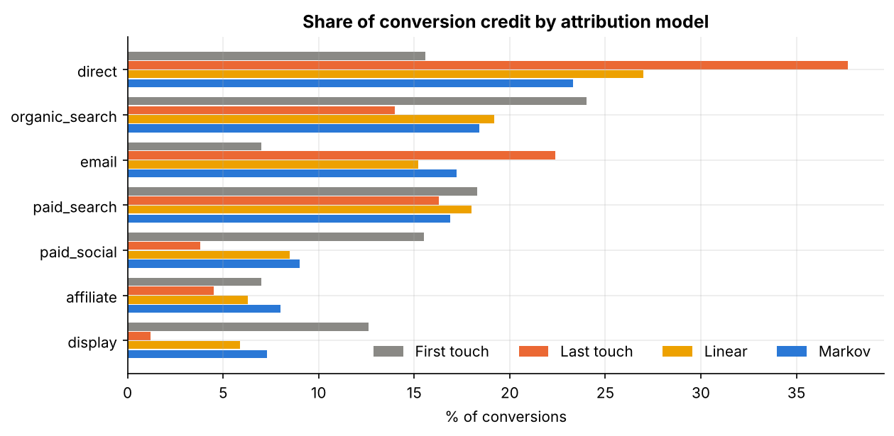
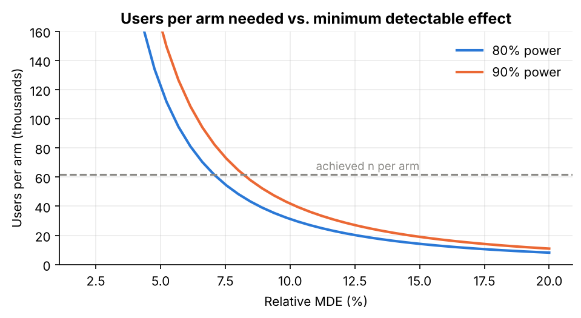
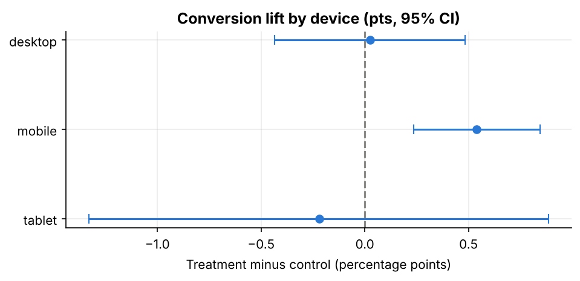
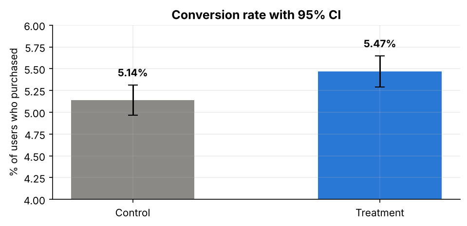
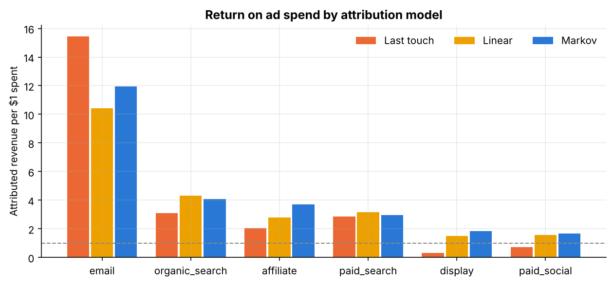

# A/B Testing & Marketing Attribution

**Two statistics-heavy case studies on e-commerce data: (1) a rigorously designed and analysed checkout experiment, and (2) a comparison of rule-based and data-driven attribution models that changes a budget decision.**



> **Reports:** [`docs/analysis_report.md`](docs/analysis_report.md) · **Pre-analysis design:** [`docs/experiment_design.md`](docs/experiment_design.md)
> Companion to [`retention-ltv-analysis`](https://github.com/adityayadav93/retention-ltv-analysis), whose onboarding recommendation is exactly the kind of change this project shows how to test.
> *Data is synthetic and seeded. Both datasets come from known generating processes, which allows results to be checked against ground truth.*

## 1. Business context and problem

- **Experiment.** The product team redesigned checkout into a single page. Should it ship, for whom, and what is it worth?
- **Attribution.** Marketing reports on last-touch conversions. Which channels does that mislead us about, and what would a data-driven view do to budget decisions?

## 2. Key insights and financial impact

| # | Finding | Evidence |
|---|---|---|
| 1 | **The one-page checkout lifts conversion by +0.33 pts (+6.4% relative, 95% CI +1.5% to +11.5%)** and revenue per visitor by +11.9%. | z-test p = 0.0098; bootstrap and CUPED agree on revenue |
| 2 | **The gain is concentrated on mobile** (+0.54 pts, Holm p = 0.0025); desktop and tablet show nothing. | Pre-specified segments, Holm-corrected; interaction test borderline (p = 0.052) |
| 3 | **Estimated value: about $1.7M incremental revenue per year** (95% CI ~$0.9M to $2.6M) at an assumed 3.0M annual visitors. | CUPED-adjusted RPV difference x traffic |
| 4 | **Last-touch attribution says display (ROAS 0.3) and paid social (0.7) lose money; the Markov model says they return 1.8 and 1.7.** Cutting them would remove traffic that feeds later conversions. | Removal-effect Markov chain on 100K journeys |
| 5 | **Single-touch rules misallocate about 19-20% of credit; the Markov model under 1%.** Display gets 6x its last-touch credit under Markov. | Validated against the true generating process |

**Recommendation.** Ship the checkout (prioritise mobile, monitor refunds, since the guardrail passed only narrowly). Do not cut display or paid social on last-touch evidence alone; confirm with a holdout test.

## 3. What this project demonstrates

| Skill | Where |
|---|---|
| Experiment design: hypothesis, metrics, MDE, power, sample size, guardrails, pre-specified segments | [`docs/experiment_design.md`](docs/experiment_design.md), notebook 1 section 1 |
| Trust checks: sample ratio mismatch, covariate balance, novelty | notebook 1 section 2 and 7 |
| Inference: two-proportion z-test, Newcombe and log-RR intervals, Welch, bootstrap, CUPED, non-inferiority | notebook 1 sections 3-5 |
| Multiple testing and heterogeneity: Holm correction, likelihood-ratio interaction test | notebook 1 section 6 |
| SQL: window functions for rule-based attribution (first, last, linear, position-based, time-decay) | [`sql/attribution_queries.sql`](sql/attribution_queries.sql) |
| Markov attribution with removal effects, validated against ground truth | notebook 2 sections 3-5 |
| Translating results into decisions, with caveats | [`docs/analysis_report.md`](docs/analysis_report.md) |

| Power curve | Lift by device |
|---|---|
|  |  |

| Conversion with 95% CI | ROAS by attribution model |
|---|---|
|  |  |

## 4. Data pipeline and methodology

```
Synthetic experiment + journey data (seed 42)
  └─► SQL warehouse (DuckDB locally; PostgreSQL-compatible)
        ├─► experiment_queries.sql   arm counts, metrics, segments, daily cumulative (window functions)
        └─► attribution_queries.sql  five rule-based models via window functions
              └─► Python notebooks: inference, CUPED, bootstrap, Markov chain, validation
                    └─► docs/analysis_report.md + results/*.json
```

## 5. Repository structure

```
├── README.md
├── docs/
│   ├── experiment_design.md       hypothesis, metrics, power, validity checks (pre-analysis)
│   └── analysis_report.md         results and recommendations for both studies
├── sql/
│   ├── schema_setup.sql
│   ├── experiment_queries.sql
│   └── attribution_queries.sql
├── notebooks/
│   ├── 01_ab_test_analysis.ipynb
│   └── 02_attribution_modeling.ipynb
├── src/                           data generator and warehouse build
├── assets/                        figures
└── results/                       ab_metrics.json, attribution_metrics.json
```

## 6. Reproduce it

```bash
pip install -r requirements.txt
make all          # generate data → run SQL → execute both notebooks
```

## 7. Limitations

- Two weeks of experiment data may miss longer purchase cycles. Treat the revenue estimate as an upper-leaning planning figure (winner's curse).
- The refund guardrail has limited power (about 58% at the 1.5 pt margin); it passed by a small margin.
- Attribution models allocate observed conversions; they do not measure incrementality. Channel spend figures are illustrative assumptions.
- The Markov validation is favourable by construction (journeys are first-order Markov); real data would fit less tightly.
